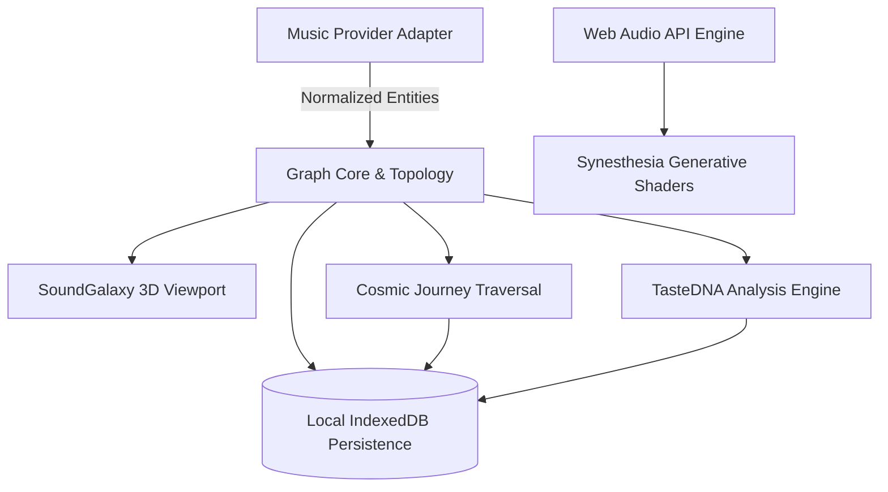

# SONARA System Architecture

## 1. Architectural Philosophy

SONARA is built around a single, unified music graph. SoundGalaxy (the 3D universe), TasteDNA (the analytics engine), and Synesthesia (generative audio visuals) are different perspectives on the same underlying relational data model.

## 2. Core Layers

### 2.1 Presentation Layer (Client App Router)
- **Framework**: Next.js 15 (React 19)
- **Styling**: Tailwind CSS with custom CSS variables adhering to the cosmic design system:
  - Deep black base (`#05060A`)
  - Elevated surfaces (`#0B0D14`, `#111521`)
  - High-contrast typography (`#F3F4F8`, `#A0A6B5`)
  - Accent accents: Cyan (`#64DFFF`), Violet (`#8C6CFF`), Muted Amber (`#E8BC83`)
- **State Management**: Reactive React state coupled to local Dexie IndexedDB tables.

### 2.2 3D Universe Layer (SoundGalaxy & Synesthesia)
- **Engine**: Three.js, React Three Fiber (v9), and Drei (v10).
- **GPU Instancing & Points**: Large populations of stars (2500+) and particles utilize single-draw call `THREE.Points` with deterministic procedural coordinate distribution.
- **Rendering & Animation**: Custom `useFrame` animation loops using delta interpolation, avoiding React re-renders during high-frequency camera transitions and particle updates.
- **Fallback**: Graceful automatic fallback to a structured 2D topological catalog when WebGL is absent or when reduced motion / accessible list mode is enabled.

### 2.3 Graph & Taste Intelligence Layer
- **MusicGraph**: Adjacency list representation supporting:
  - Breadth-First Search (BFS) for shortest unweighted hop count.
  - Dijkstra's Algorithm for optimal affinity routing weighted by `1 - edge.score`.
- **Modular Similarity Engine**: Multi-signal normalized similarity calculation over available signals (shared genre Jaccard coefficient, direct collaborator relationships, cluster co-occurrence, and acoustic features).
- **TasteDNA Engine**:
  - Simpson's Reciprocal Diversity Index ($D = 1 - \sum (n_i / N)^2$) measuring library genre dispersion.
  - Topological Bridge Artist detection discovering nodes whose relationships span two or more clusters.

### 2.4 Audio & Recording Layer
- **Web Audio API**: Single shared `AudioContext` with `AnalyserNode` performing 1024-bin FFT analysis.
- **Signal Decomposition**: Real-time extraction of Bass (20-250Hz), Mid (250-4000Hz), and Treble (4000-20000Hz) energies with attack/release exponential smoothing.
- **Procedural Synthesizer**: Built-in multi-oscillator cosmic chord generator providing instantaneous audio response without requiring user file uploads.
- **Canvas Video & Audio Recorder**: Browser `MediaRecorder` combining the WebGL canvas stream with `AudioContext` media destination into `.webm` recordings.

### 2.5 Persistence & Storage Layer
- **Technology**: IndexedDB via Dexie v4.
- **Storage Scope**:
  - `artists`: Stored catalog nodes.
  - `tracks`: Orbiting planetary track data.
  - `relationships`: Verified graph edges and explanations.
  - `clusters`: Harmonic cluster metadata and centers.
  - `journeys`: User saved Cosmic Journeys.
  - `snapshots`: Historical taste snapshots.
  - `preferences`: User settings (fidelity, motion, density, camera).

